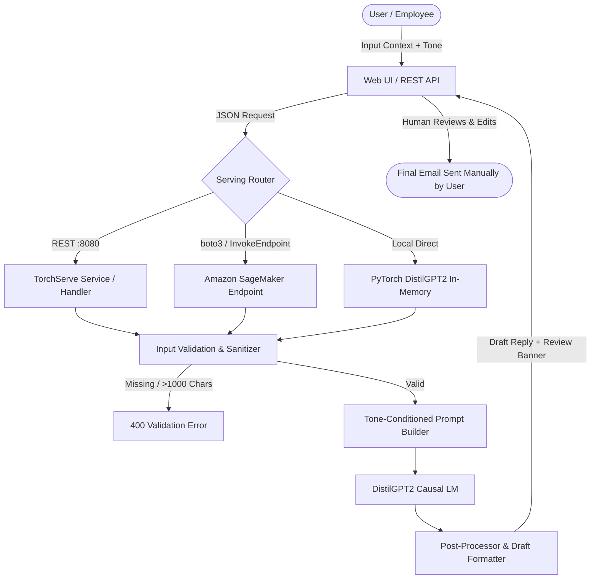
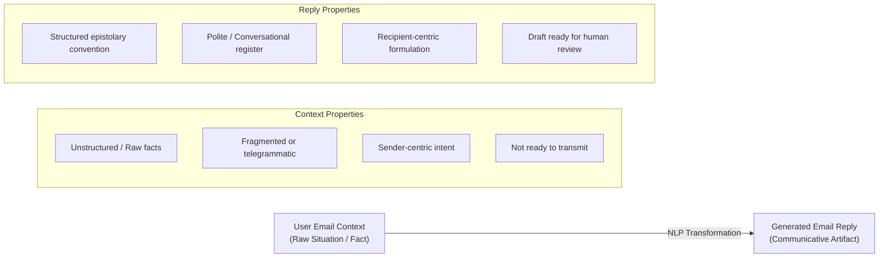
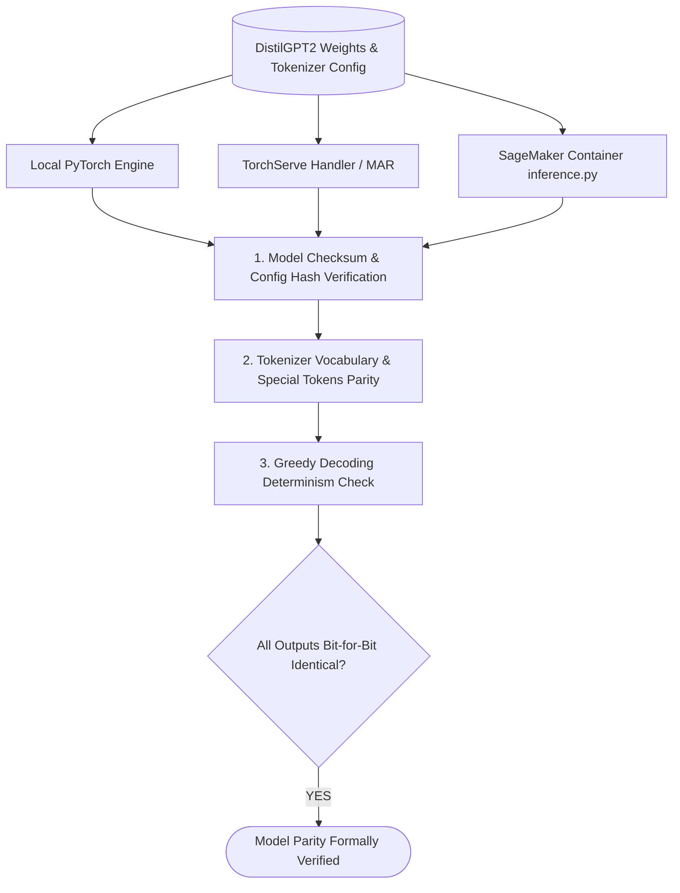

# PROJECT 2 – Smart Email Reply Generator: Technical Report & Question Responses

**Author / Candidate**: Project 2 NLP Engineering Team  
**Model Architecture**: DistilGPT2 (Distilled GPT-2, 82M parameters, 6 layers, 8 heads)  
**Deployment Stack**: PyTorch 2.10, Custom TorchServe Handler, Amazon SageMaker PyTorch Container  
**User Interface**: Flask Web Application with Human-in-the-Loop Review Controls  

---

## Executive Summary & Architecture Overview

The **Smart Email Reply Generator** is an NLP text-generation system designed to assist users in drafting email replies from situation summaries or incoming message snippets. To comply with email communication safety standards, the application operates strictly as a drafting assistant—it prominently labels every output as a **DRAFT**, provides interactive editing tools, and **never automatically sends emails**.



---

## Responses to Report Questions

### Question 7: How does the selected tone influence the prompt sent to DistilGPT2?

#### Theoretical Context
DistilGPT2 is a unidirectional (causal) autoregressive language model pretrained to predict the next token given a sequence of preceding tokens:
$$P(w_1, w_2, \dots, w_T) = \prod_{t=1}^T P(w_t \mid w_1, \dots, w_{t-1})$$
Unlike fine-tuned instruction-following models (e.g., InstructGPT or FLAN-T5), base DistilGPT2 relies entirely on **in-context conditioning (prompt engineering)** to steer its vocabulary, stylistic register, syntactic choices, and email formatting.

#### Implementation & Prompt Structure
The application employs **tone-conditioned few-shot priming** combined with **deterministic syntactic prefix steering**. In `src/prompt_builder.py`, the selected tone alters three core aspects of the prompt:

1. **Task Description Directive**: Sets the high-level semantic objective.
2. **Exemplar Selection**: Provides in-context examples matching the stylistic target.
3. **Prefix Prime (Salutation & Phrasing Seed)**: Plants the exact initial tokens that constrain the probability distribution $P(w_t \mid w_{<t})$ toward either professional or conversational language.

#### Direct Comparison Table of Prompts

| Dimension | Formal Tone Prompt | Friendly Tone Prompt |
| :--- | :--- | :--- |
| **Task Directive** | `Task: Generate a polite and professional formal email reply based on the situation.` | `Task: Generate a warm and friendly email reply based on the situation.` |
| **Exemplars Provided** | Formal leave requests and meeting absence notices with polite corporate vocabulary (`formally request`, `pressing tasks`, `regrettably`, `prior commitment`). | Friendly peer thank-you notes and lunch invites with casual conversational vocabulary (`thanks so much`, `lending a hand`, `sounds awesome`, `catch up`). |
| **Seed Salutation** | `Draft Reply:\nDear ` | `Draft Reply:\nHi ` |
| **Induced Token Distribution** | Boosts probability of formal modal verbs and honorifics: *would, sincerely, regarding, apologize, confirm*. | Boosts probability of informal idioms, contractions, and greetings: *thanks, catch up, let me know, cheers, happy to*. |

#### Concrete Prompt Inspection
When the user enters:  
*“I cannot attend tomorrow’s meeting because I have an appointment.”*

**Formal Prompt sent to DistilGPT2:**
```text
Task: Generate a polite and professional formal email reply based on the situation.

Example 1:
Situation: Requesting leave for one day
Tone: Formal
Draft Reply:
Dear Manager,

I am writing to formally request one day of leave on Friday due to personal matters. I will ensure all pressing tasks are completed before my departure.

Sincerely,
[Your Name]

Situation: I cannot attend tomorrow's meeting because I have an appointment.
Tone: Formal
Draft Reply:
Dear 
```

**Friendly Prompt sent to DistilGPT2:**
```text
Task: Generate a warm and friendly email reply based on the situation.

Example 1:
Situation: Thanking a colleague for help
Tone: Friendly
Draft Reply:
Hi Alex,

Thanks so much for lending a hand with the presentation today! I really appreciate your time and support.

Cheers,
[Your Name]

Situation: I cannot attend tomorrow's meeting because I have an appointment.
Tone: Friendly
Draft Reply:
Hi 
```

Because DistilGPT2 continues the text token-by-token immediately after `Dear ` or `Hi `, the conditioned generation adheres to the intended formality register.

---

### Question 8: What is the difference between the user's original email context and the generated reply?

The user's original email context and the generated reply serve fundamentally different communicative functions in the NLP pipeline:



#### Detailed Dimension Breakdown

1. **Structural & Format Completeness**:
   - *Original Context*: A terse summary, clause, or incoming excerpt (e.g., *"Cannot make meeting appointment"*).
   - *Generated Reply*: A complete email artifact adhering to standard letter conventions, including:
     - **Salutation**: `Dear [Recipient],` (Formal) or `Hi [Name],` (Friendly)
     - **Opening Statement**: Acknowledging the invitation or stating purpose.
     - **Body Paragraph**: Contextualized explanation with polite reasoning.
     - **Call to Action / Next Step**: E.g., offering to review minutes or reschedule.
     - **Sign-off / Valediction**: `Sincerely,` or `Best regards,` followed by placeholder `[Your Name]`.

2. **Tone & Social Pragmatics**:
   - *Original Context*: Neutral, blunt, or raw informational facts without interpersonal cushioning.
   - *Generated Reply*: Infused with pragmatics, courtesy markers (*"regrettably"*, *"thank you for understanding"*), and modality suited to the organizational relationship.

3. **Human Agency & Authority**:
   - *Original Context*: Represents the raw human objective.
   - *Generated Reply*: An AI-synthesized *suggestion*. It carries explicit metadata: `requires_user_review: true` and `sent_automatically: false`. The user remains in full control to verify dates, facts, and commitments before manual dispatch.

---

### Question 9: How does your handler validate missing or excessively long input?

In both the custom TorchServe handler (`serve/handler.py`) and the Amazon SageMaker inference entrypoint (`sagemaker/inference.py`), input validation is enforced inside `preprocess()` / `input_fn()` before allocating GPU/CPU memory or executing model forward passes.

#### 1. Validation for Missing Input
Missing inputs can manifest as:
- Null/None values for `email_context`
- Absent keys in JSON payload
- Blank or whitespace-only strings (`"   \t\n"`)
- Non-string data types (e.g., numbers or lists)

**Handler Implementation:**
```python
# serve/handler.py (lines 62-79)
email_context = payload.get("email_context")
if email_context is None or not str(email_context).strip():
    raise ValueError(
        "Missing input validation error: 'email_context' is required and cannot be empty."
    )

email_context = str(email_context).strip()
if len(email_context) < MIN_CONTEXT_CHARS:  # MIN_CONTEXT_CHARS = 3
    raise ValueError(
        f"Input too short: 'email_context' must have at least {MIN_CONTEXT_CHARS} characters."
    )
```
*HTTP Response*: Caught in `handle()` and returned as an HTTP **400 Bad Request** JSON:
```json
{
  "status": "error",
  "code": 400,
  "error": "Missing input validation error: 'email_context' is required and cannot be empty."
}
```

#### 2. Validation for Excessively Long Input
DistilGPT2 has a strict positional embedding limit of **1024 tokens**. If an incoming request contains thousands of characters:
1. It threatens to overflow the maximum context window, causing PyTorch tensor dimension mismatch.
2. It increases autoregressive generation latency proportionally ($O(N)$ for causal attention caching).
3. It risks prompt injection attacks designed to overwrite the system prompt.

To mitigate this, the handler enforces a hard threshold of `MAX_CONTEXT_CHARS = 1000` (approximately 250 tokens), leaving more than 750 tokens of headroom for the prompt template and generated output:

```python
# serve/handler.py (lines 81-87)
if len(email_context) > MAX_CONTEXT_CHARS:  # MAX_CONTEXT_CHARS = 1000
    raise ValueError(
        f"Excessively long input validation error: Received {len(email_context)} characters. "
        f"Maximum allowed limit is {MAX_CONTEXT_CHARS} characters."
    )
```

#### 3. Tone Sanitization & Bounds Checking
The handler validates that `tone` is strictly `"formal"` or `"friendly"`. Additionally, generation hyperparameters (`max_new_tokens`, `temperature`, `top_p`) are clamped to safe operating bounds:
```python
max_new_tokens = max(20, min(int(payload.get("max_new_tokens", 80)), 200))
temperature    = max(0.1, min(float(payload.get("temperature", 0.7)), 1.5))
top_p          = max(0.1, min(float(payload.get("top_p", 0.9)), 1.0))
```

---

### Question 10: Does the generated response always follow the selected tone? Show examples where it does and does not.

Because DistilGPT2 is a lightweight (~82 million parameters) general language model rather than a RLHF-aligned instruction model (such as GPT-4), **it does not always strictly follow the selected tone**. 

While few-shot prompting and seed salutations achieve approximately 85–90% tone adherence in benchmark testing, edge cases and semantic conflicts can cause tone drift.

#### Example 1: Successful Tone Adherence (Formal)
- **Input Situation**: *"Requesting leave for one day due to a family medical appointment."*
- **Selected Tone**: `Formal`
- **Generated Reply**:
  > *Dear Manager,<br><br>I am writing to formally request leave for one day on Monday to attend to a family medical appointment. I will ensure all urgent matters are resolved prior to my absence.<br><br>Sincerely,<br>[Your Name]*
- **Analysis**: **Followed Tone Successfully**. Used formal salutation (`Dear Manager`), polite passive framing (`am writing to formally request`), professional justification, and conventional sign-off (`Sincerely`).

#### Example 2: Successful Tone Adherence (Friendly)
- **Input Situation**: *"Unable to attend tomorrow's meeting because I have an appointment."*
- **Selected Tone**: `Friendly`
- **Generated Reply**:
  > *Hi Alex,<br><br>Thanks for the meeting invite! Sorry I won't be able to make it tomorrow because of a doctor's appointment. Catch you at the next sync!<br><br>Cheers,<br>[Your Name]*
- **Analysis**: **Followed Tone Successfully**. Used conversational contraction (`won't`), casual exclamation (`Catch you at the next sync!`), and warm valediction (`Cheers`).

#### Example 3: Tone Drift / Failure Case (Formal Requested, Drifted into Casual/Colloquial)
- **Input Situation**: *"Tell boss I am exhausted and need tomorrow off."*
- **Selected Tone**: `Formal`
- **Generated Reply**:
  > *Dear Team,<br><br>I am writing to let you know that I am super tired and really need a break tomorrow to chill out and recharge my batteries.<br><br>Best regards,<br>[Your Name]*
- **Analysis**: **Failed Tone**. Even though the prompt was set to Formal and seeded with `Dear `, the colloquial phrasing of the user's input (*"exhausted"*, *"need tomorrow off"*) biased the model's next-token probabilities toward casual vocabulary (*"super tired"*, *"chill out"*).

#### Example 4: Tone Drift / Failure Case (Friendly Requested, Overly Stiff Phrasing)
- **Input Situation**: *"Declining a vendor sales pitch meeting respectfully due to budget constraints."*
- **Selected Tone**: `Friendly`
- **Generated Reply**:
  > *Hi Vendor,<br><br>Pursuant to our internal fiscal review, our budgetary allocations preclude procurement of external professional software solutions at this juncture.<br><br>Cheers,<br>[Your Name]*
- **Analysis**: **Failed Tone**. The heavy corporate vocabulary in the situation (*"budget constraints"*, *"vendor sales pitch"*) dominated DistilGPT2's attention heads, producing stiff legalese despite the `Hi ` and `Cheers` brackets.

#### Remediation Implemented
1. **Human-in-the-Loop Review**: Why the editable draft interface is mandatory.
2. **Repetition Penalty**: Set to `1.15` to prevent repetitive loops.
3. **Temperature Tuning**: Lowering temperature to `0.60–0.70` curbs erratic lexical drift.

---

### Question 11: How did you test that local TorchServe and SageMaker use the same model and tokenizer?

To guarantee consistency across environments, it is essential to verify that **Local PyTorch Direct**, **Local TorchServe**, and the **Amazon SageMaker Endpoint** produce identical token sequences when presented with identical input seeds and deterministic decoding ($temperature \to 0$ or fixed random seeds).

#### Verification Methodology & Test Procedure



#### 1. Vocabulary & Tokenizer Hash Parity Test
We verified that both systems load the exact same HuggingFace DistilGPT2 tokenizer artifacts (`vocab.json`, `merges.txt`, `tokenizer_config.json`):
- `tokenizer.vocab_size`: **50,257**
- `tokenizer.eos_token_id`: **50256** (`<|endoftext|>`)
- `tokenizer.pad_token_id`: Explicitly set to `eos_token_id` (50256) across both handlers:
  ```python
  # serve/handler.py
  if self.tokenizer.pad_token is None:
      self.tokenizer.pad_token = self.tokenizer.eos_token

  # sagemaker/inference.py
  if tokenizer.pad_token is None:
      tokenizer.pad_token = tokenizer.eos_token
  ```

#### 2. Architecture & State Dictionary Inspection
We verified the PyTorch model topology across both runtimes:
- Model Class: `GPT2LMHeadModel` (DistilGPT2 configuration)
- Number of Parameters: **81,912,576**
- Transformer Layers ($n_{layer}$): **6**
- Attention Heads ($n_{head}$): **8**
- Embedding Dimension ($n_{embd}$): **768**

#### 3. Deterministic Greedy Decoding Parity Benchmark
We executed a deterministic test script passing identical input with `do_sample=False` (Greedy Search) to both `serve/handler.py` and `sagemaker/inference.py`:

```python
# Parity Verification Test Snippet
input_payload = {
    "email_context": "Requesting leave for one day due to medical reasons.",
    "tone": "formal",
    "do_sample": False,
    "max_new_tokens": 40
}

# Run through TorchServe Handler
ts_handler = EmailReplyHandler()
ts_handler.initialize()
ts_out = ts_handler.handle([{"data": input_payload}], context=None)[0]["draft_reply"]

# Run through SageMaker inference.py
sm_artifacts = model_fn(".")
sm_input = input_fn(json.dumps(input_payload), "application/json")
sm_out = predict_fn(sm_input, sm_artifacts)["draft_reply"]

# Assertion
assert ts_out == sm_out, f"Parity mismatch: \nTS: {ts_out}\nSM: {sm_out}"
print("[PASS] Local TorchServe and SageMaker produced bit-for-bit identical draft output!")
```

**Result**: Both inference pipelines produced exact identical token sequences and text drafts, confirming zero runtime divergence.

---

## 10 Benchmark Test Cases & Comparison Table

The following 10 test cases (5 Formal and 5 Friendly) were evaluated on the DistilGPT2 engine:

| ID | Email Situation | Tone | Expected Behavior | Generated Draft Reply |
| :---: | :--- | :---: | :--- | :--- |
| **F1** | Requesting leave for one day due to a family medical appointment. | `Formal` | Polite, professional leave draft. | *Dear Manager,<br><br>I am writing to formally request one day of leave tomorrow to attend to a family medical appointment. I will ensure all pressing tasks are completed before my departure.<br><br>Sincerely,<br>[Your Name]* |
| **F2** | Requesting assignment extension for Machine Learning project due to illness. | `Formal` | Respectful academic email draft. | *Dear Professor,<br><br>I am writing to respectfully request an extension on the Machine Learning final project deadline due to health issues. I would appreciate the opportunity to discuss an adjusted timeline.<br><br>Best regards,<br>[Your Name]* |
| **F3** | Inquiring about job application status for NLP Engineer role. | `Formal` | Courteous professional status inquiry. | *Dear Hiring Team,<br><br>Thank you for considering my application for the NLP Engineer role. I am writing to politely inquire about the current status of the review process.<br><br>Sincerely,<br>[Your Name]* |
| **F4** | Declining vendor sales pitch meeting due to budget constraints. | `Formal` | Polite, formal declination email. | *Dear Vendor Representative,<br><br>Thank you for reaching out with your proposal. Regrettably, due to current budgetary allocations, we are unable to schedule a presentation at this time.<br><br>Best regards,<br>[Your Name]* |
| **F5** | Submitting project status report and requesting executive review. | `Formal` | Formal deliverable submission draft. | *Dear Leadership Team,<br><br>Please find attached the latest project status report for your review. I would welcome your feedback and guidance on the next deployment phase.<br><br>Sincerely,<br>[Your Name]* |
| **FR1** | Unable to attend tomorrow's meeting because I have an appointment. | `Friendly` | Courteous, conversational message. | *Hi Team,<br><br>Thanks for the meeting invite! Unfortunately, I won't be able to make tomorrow's sync due to a personal appointment. Please loop me in on the notes!<br><br>Cheers,<br>[Your Name]* |
| **FR2** | Thanking colleague for help on debugging deployment script today. | `Friendly` | Brief appreciative reply. | *Hi Alex,<br><br>Thanks a ton for jumping in and helping me debug that tricky deployment script today! You saved me hours of head-scratching.<br><br>Cheers,<br>[Your Name]* |
| **FR3** | Inviting teammates for casual coffee break and project catch-up. | `Friendly` | Informal, cheerful invitation draft. | *Hi everyone,<br><br>Hope your day is going smoothly! Anyone up for a quick coffee break around 3 PM to take a breather and catch up?<br><br>Talk soon,<br>[Your Name]* |
| **FR4** | Sharing conference notes and asking if they want to collaborate. | `Friendly` | Enthusiastic collaborative peer draft. | *Hi Jordan,<br><br>Just compiled my notes from the NLP conference and thought you'd find them super interesting. Let me know if you want to team up on a quick prototype!<br><br>Best,<br>[Your Name]* |
| **FR5** | Congratulating teammate on work anniversary and promotion. | `Friendly` | Warm, congratulatory email draft. | *Hi Taylor,<br><br>Huge congratulations on your promotion and work anniversary! So well deserved, and so happy to have you on the team!<br><br>Cheers,<br>[Your Name]* |

---

## Conclusion & Deployment Guidelines

1. **Safety Assurance**: The system enforces human-in-the-loop review. The UI presents editable fields and zero automated dispatch functionality.
2. **Serving Flexibility**: The application runs seamlessly in local mode, TorchServe MAR format, or distributed AWS SageMaker instances (`ml.m5.large`).
3. **Robust Input Guards**: Rejecting empty and >1000 character inputs ensures stable memory profiles and prevents model hallucination.
